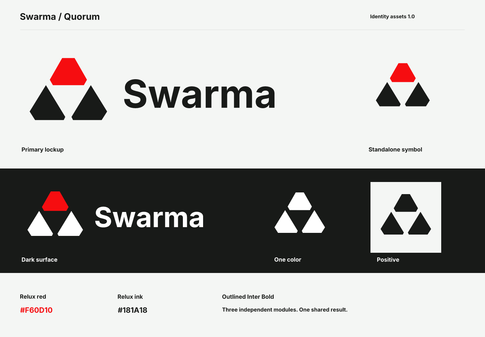

# Swarma brand assets

<picture>
  <source media="(prefers-color-scheme: dark)" srcset="assets/svg/swarma-lockup-horizontal-dark.svg">
  
</picture>

The source of truth for the Swarma **Quorum** identity. The approved mark consists
of three independent modules around an open triangular center, with the upper
module in Relux red. Direction 02 was selected on 26 October 2026.

## Choose an asset

| Use | File or folder |
| --- | --- |
| Website header, light background | [Horizontal SVG](assets/svg/swarma-lockup-horizontal.svg) |
| Website header, dark background | [Horizontal dark SVG](assets/svg/swarma-lockup-horizontal-dark.svg) |
| Compact symbol | [Symbol SVG](assets/svg/swarma-symbol.svg) |
| Centered composition | [Stacked SVG](assets/svg/swarma-lockup-stacked.svg) |
| Name without the symbol | [Outlined wordmark](assets/svg/swarma-wordmark.svg) |
| Profile image | [Light avatar, 512 px](assets/png/swarma-avatar-light-512.png) / [dark avatar, 512 px](assets/png/swarma-avatar-dark-512.png) |
| One-color use | SVG files ending in `-mono.svg` or `-white.svg` |
| Browser and app icons | [SVG, PNG and ICO icons](assets/icons/) |
| Raster artwork | [PNG exports](assets/png/) |
| Every generated file and its checksum | [Asset manifest](assets/manifest.json) |

The symbol, horizontal lockup and stacked lockup have light, dark, monochrome and
white variants. Transparent exports retain their transparency. Avatars and PNG/ICO
favicons have a solid background so they remain legible on unknown surfaces.



## Use the identity

Read the [usage guide](docs/USAGE.md) for colors, clear space, minimum sizes, web
integration and the relationship to Relux Works. All shipped SVG lettering is
outlined: consumers do not need to install a font.

[Provenance](docs/PROVENANCE.md) records the selected concept, vector construction
and font source. The full exploration board is retained only as a reference; its
other three concepts are not approved assets.

## Repository

```text
source/       Editable symbol master and licensed font
assets/svg/   Path-only production artwork
assets/png/   Transparent logos and plated avatars
assets/icons/ Favicons, Apple touch icon and app icons
docs/         Usage, provenance, validation and visual preview
references/   Original concept board
.scripts/     Deterministic build and validation commands
```

The separate [Swarma platform design system](https://github.com/relux-works/swarma-platform-design-system)
can consume these files. This repository owns the artwork and exports.

## Tools and reproducible build

Use Node.js 22 or newer. Package versions and platform renderer binaries are pinned
by `package-lock.json`. There are no system-font or browser dependencies.

```sh
npm ci --ignore-scripts --no-fund --no-audit
npm run verify
```

| Tool | Purpose | Entry point and output |
| --- | --- | --- |
| Node.js / npm | Run the asset pipeline | `npm run build` writes `assets/` and `docs/asset-preview.*` |
| `opentype.js` 2.0.0 | Outline the bundled Inter Bold glyphs with pair kerning | Used by `.scripts/artwork.mjs`; no live text in exports |
| `@resvg/resvg-js` 2.6.2 | Render the exact SVG paths to PNG and inspect RGBA geometry | Used by build and validation; pinned native renderer |
| Validator | Check shapes, colors, transparency, file inventory, hashes and ICO frames | `npm run check`; prints the result, writes no files |
| GitHub Actions | Rebuild on a pull request and on `main`; reject generated-file drift | [Validate brand assets](.github/workflows/validate.yml) |
| Git | Export the complete repository at an exact revision | `mkdir -p .temp && git archive --format=zip --output=.temp/swarma-brand-assets.zip HEAD` |

`npm run verify` builds first, then validates. `npm run check` validates the files
already present without changing them. The [validation record](docs/VALIDATION.md)
describes the claims and their limits. Keep local logs and scratch work in `.temp/`.

Edit `source/swarma-symbol.svg` only for an approved artwork change. Regenerate and
review the complete export set; do not hand-edit derived assets. Consumer projects
should pin a repository commit and use the manifest checksums when copying files.

## Rights

Swarma artwork is the product identity of Relux Works. This repository does not
grant a separate trademark or artwork license. The bundled Inter font retains its
[SIL Open Font License 1.1](source/fonts/OFL.txt).
